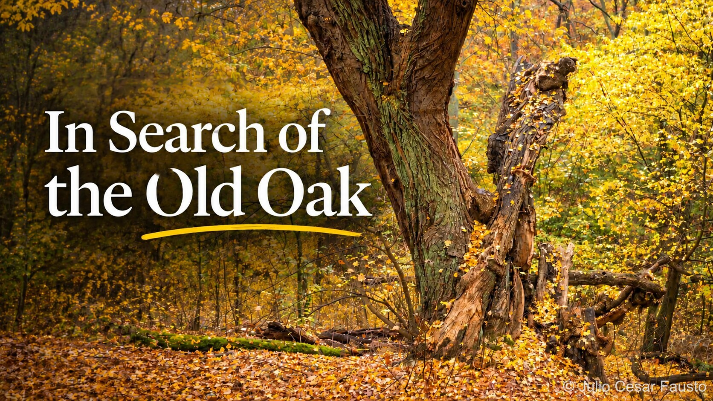
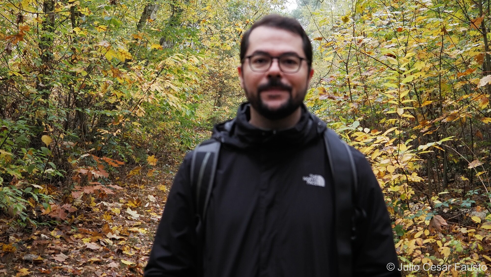
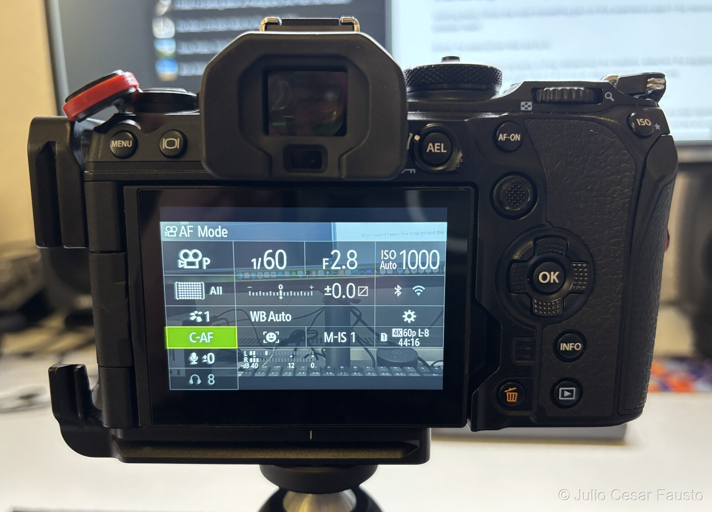

Last weekend, I went out to explore an unfamiliar woodland in search of centuries-old oak trees. I eventually found the tree I was looking for, but along the way, I learned an important lesson about planning, preparation, and knowing my equipment.

My priority for the day was photography. I wanted to explore a new location, discover interesting compositions, and hopefully return home with a few photographs worth sharing. However, I also wanted to document the experience on video, recording some of the exploration and the decisions I made along the way.

The idea was to produce a YouTube video about my little adventure, combining the photographs with footage from the woodland and some commentary recorded on location.

For that, I brought my DJI Osmo Action 4, which I intended to use mainly for B-roll footage and for recording myself talking during different parts of the outing.

The action camera did its job perfectly. The footage was sharp, the recordings were usable, and I eventually managed to produce the video as I had intended.

You can watch the video here: [https://youtu.be/TnSgHsbW38c](https://youtu.be/TnSgHsbW38c)

Unfortunately, I couldn't say the same about the footage from my other camera.

## A perfectly capable camera, but unusable footage

Since I was already photographing with a perfectly capable video camera, my OM SYSTEM OM-1 Mark II, I decided to record a few additional clips with it.

I thought it would be a good opportunity to capture some footage with a different perspective and perhaps take advantage of the image quality and flexibility offered by my photography lenses.

Everything seemed fine while I was recording.

However, when I got home and started reviewing the footage, I discovered that every single clip in which I was talking to the camera had the same problem: I was completely out of focus.

The background looked reasonably sharp, but I was a blurry figure standing in front of it.

It was disappointing, particularly because some of those recordings contained commentary that would have been useful for the final video.

Fortunately, the Osmo Action 4 footage was perfectly usable, so I wasn't left without material. Still, I had lost an opportunity to make the video more interesting by combining footage from both cameras.

More importantly, I realised that I had made a fundamental mistake: I had assumed that knowing how to use my camera for photography meant I could also use it confidently for video.

As it turned out, that wasn't quite true.

## Investigating what went wrong

Back at home, I decided to investigate.

My first suspicion was that I hadn't configured the autofocus correctly. After all, when recording myself talking to the camera, I need the camera to keep me in focus even when I move, turn my head, or gesture.

I opened the camera's video settings and tried to change the focusing mode from MF (Manual Focus) to AF (Autofocus).

To my surprise, I couldn't.

No matter what I tried, the camera seemed determined to remain in manual focus mode.

For a couple of minutes, I navigated through the menus, checked different settings, and tried to understand what was preventing me from enabling autofocus.

Eventually, I gave up trying to figure it out myself and turned to the internet in search of an answer.

The solution was surprisingly simple. So simple, in fact, that I felt a little embarrassed for not having noticed it earlier.

But it also revealed how much I still have to learn about this particular camera, which, to be fair, I acquired only a few months ago.

## The culprit: the lens's manual focus clutch

The problem wasn't in the camera's menus.

It was on the lens itself.

I was using my M.Zuiko Digital ED 12-40mm F2.8 PRO, a lens equipped with a manual focus clutch mechanism.

This mechanism allows you to switch between the normal focusing operation and manual focusing by sliding the focus ring forward or backward along the lens barrel.

When the focus ring is pulled toward the camera body, the manual focus clutch is engaged. This activates the lens's manual focusing mechanism, overriding the camera's normal autofocus operation.

When the ring is pushed forward, away from the camera body, the clutch is disengaged, allowing the camera to control the focusing mode again.

Here's the clutch engaged, with the lens in manual focus, and disengaged, with the lens in autofocus:

{% include essay-pair.html display="text"
   src1="/assets/images/photography/journal/how-much-planning-is-too-much/om1-mark2-focus-ring-clutch-in-manual-focus.jpg"
   alt1="OM-1 Mark II lens with the focus ring pulled back, manual focus clutch engaged"
   caption1="Clutch engaged: manual focus"
   src2="/assets/images/photography/journal/how-much-planning-is-too-much/om1-mark2-focus-ring-clutch-in-auto-focus.jpg"
   alt2="OM-1 Mark II lens with the focus ring pushed forward, manual focus clutch disengaged"
   caption2="Clutch disengaged: autofocus" %}

And that was exactly my problem.

For photography, I've been using manual focus quite frequently lately, so I had left the clutch engaged.

When I switched the camera to video mode, I simply assumed that it would use the autofocus settings I had configured for video.

But the lens was still physically set to manual focus.

The camera wasn't malfunctioning. It was doing exactly what I had instructed it to do, even though I hadn't realised I was giving it those instructions.

Once I pushed the focus ring forward, disengaging the manual focus clutch, I was able to select the autofocus options again.

I then configured the video mode to use C-AF (Continuous Autofocus) and enabled subject detection, so the camera could recognise and track me while I was speaking, moving, and gesturing in front of the lens.

Camera's video settings showing C-AF and subject detection:

A quick test at home confirmed that autofocus was working again.

Such a small mechanical detail had made the difference between usable footage and an entire collection of blurry recordings.

## What this taught me about preparation

Looking back, I think the most interesting part of this experience wasn't the technical problem itself.

It was the assumption that led to it.

I had planned the photography outing, researched the location, selected the equipment I wanted to bring, and thought about the kind of video I wanted to produce.

But I hadn't taken the time to test the video setup before leaving home.

I knew the camera was capable of recording excellent video. I knew the lens was capable of autofocus. And I assumed that switching the camera to video mode would be enough.

What I didn't consider was how my photography setup might interfere with my video setup.

The irony is that I spent time preparing for the things I couldn't control, such as the location, the light, and the photographic opportunities I might encounter, while overlooking something entirely within my control: making sure the equipment was configured correctly.

This brings me back to the question: How much planning is too much?

I don't think the answer is to plan every detail. In fact, one of the things I enjoy most about exploring unfamiliar locations is the possibility of discovering something unexpected.

I don't want to arrive with every shot already imagined, every composition decided, or every minute planned.

But there's a difference between planning the experience and preparing the equipment that makes it possible.

The first should leave room for exploration and spontaneity. The second should remove unnecessary obstacles.

And perhaps that's the lesson I needed to learn.

## A small change for the next outing

For my next outing, I intend to introduce a simple habit: before leaving home, I'll record a short test clip using exactly the setup I plan to use in the field.

I'll check the focusing mode, verify that subject detection is working, make sure the lens is configured correctly, and review the recording to confirm that everything looks as expected.

I'll also make a quick test recording on location before starting any important commentary.

All of that won't take more than a couple of minutes, but it could save me from bringing home another collection of unusable footage.

Of course, there will always be mistakes, unexpected problems, and things that don't go according to plan. That's part of learning, and perhaps even part of what makes these outings interesting.

This time, I returned home with photographs I was happy with, enough video footage to tell the story, and a technical lesson I won't easily forget.

And now I know something I didn't know before.

Sometimes, being better prepared doesn't mean carrying more equipment, planning more photographs, or spending more time researching a location.

Sometimes, it simply means remembering to check a small ring on your lens.
